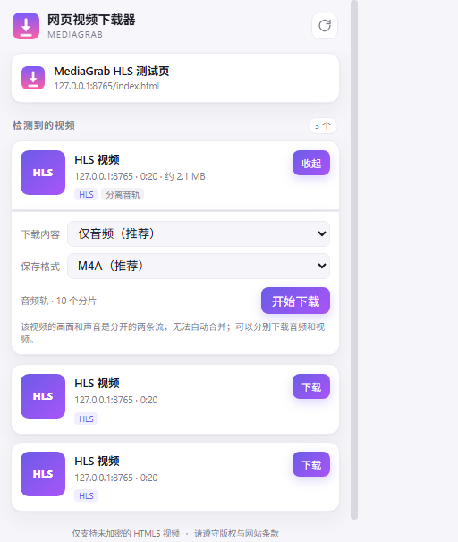

# MediaGrab

[](https://github.com/wheatnobeer/mediagrab/actions/workflows/ci.yml)
[中文说明](README.md) · [Changelog](CHANGELOG.md)

A dependency-free Chrome Manifest V3 extension that detects HLS/MP4 media on the
current page, downloads segments, decrypts AES-128, remuxes to MP4, and saves the
result locally.



> **Legal notice:** use this only for content you are allowed to save. The project
> does **not** bypass Widevine, PlayReady, FairPlay, SAMPLE-AES, or any other DRM.
> DRM-protected media is detected and refused.

## Features

- Detect HLS (`.m3u8`), MP4/WebM, and audio URLs from the page
- HLS quality selection, MPEG-TS and fMP4 segments, `EXT-X-BYTERANGE`
- AES-128 decryption (key rotation, IV, relative URLs, Base64/Hex keys)
- TS → MP4 via mux.js, or save TS as-is
- Separate audio/video HLS: download audio-only (M4A) or video-only (MP4)
- Rewrite fMP4 track IDs to 1/2 (fixes source `track_ID = 0`)
- Progress, speed, ETA, cancel, completion notifications
- DRM detection and refusal; all processing stays local

## Install (unpacked)

1. Open `chrome://extensions` and enable **Developer mode**
2. Click **Load unpacked**
3. Select the **`extension`** folder (the one containing `manifest.json`)
4. Pin the extension and open a video page

No build step, no `npm install`.

## Usage

Start playback, open the popup, choose a stream, then pick quality/format and
download. If the page was already open before installing, refresh it once.

For separate audio/video streams, the popup offers **Audio only** and **Video
only**. Merge them with ffmpeg if needed:

```bash
ffmpeg -i video.mp4 -i audio.m4a -c copy output.mp4
```

## Limitations

- No DRM bypass (Widevine / PlayReady / FairPlay / SAMPLE-AES)
- No live streams
- No automatic audio+video merging
- DASH (`.mpd`) is detected but not downloaded
- Some sites use per-session keys or special request headers and may still fail

## Development

```bash
npm run check     # manifest and JS syntax
npm test          # parser, AES key, fMP4 track-ID unit tests
npm run pack      # dist/MediaGrab-extension-<version>.zip
```

Full local HLS integration tests are described in [test/README.md](test/README.md).

## License

MIT. Third-party notices: [THIRD_PARTY_NOTICES.md](THIRD_PARTY_NOTICES.md).
