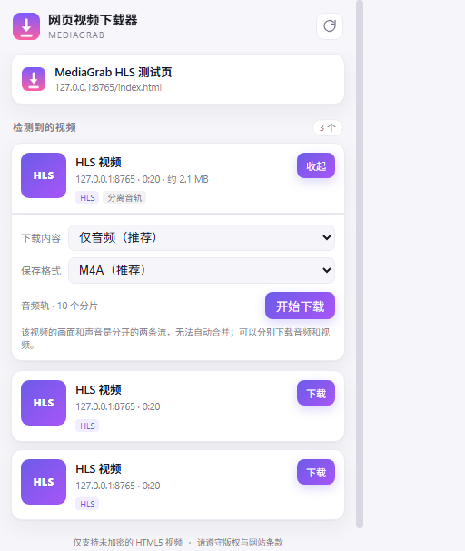

# MediaGrab · 网页视频下载器


一个无构建、无远程代码的 Chrome Manifest V3 扩展：嗅探当前页面正在播放的
**HLS / MP4** 视频，下载分片、解密 AES-128、合并并转封装为 MP4 后保存到本地。



> **合规声明**：仅用于下载你有权保存的内容（例如已购买内容的个人离线备份）。
> 本项目**不会绕过 Widevine / PlayReady / FairPlay 等 DRM**，受 DRM 保护的内容会
> 直接提示无法下载。请遵守目标网站条款和当地法律。

---

## 功能

- 自动嗅探页面中的 HLS（`.m3u8`）与 MP4 / WebM / 音频直链
- HLS：
  - 主清单多清晰度选择（1080p / 720p / …）
  - MPEG-TS 与 fMP4 分片
  - AES-128 解密（`EXT-X-KEY` 轮换、IV、相对地址、Base64/Hex 密钥）
  - `EXT-X-BYTERANGE` 分片
  - TS 自动转封装为 MP4（mux.js），也可选择「TS 原样」
  - 音视频分离的 HLS：可分别下载「仅音频」或「仅视频」
  - 音频流保存为 M4A
  - 自动把 fMP4 轨道号规范为 1、2…，避免 `track_ID = 0` 导致编辑器导入异常
- 下载进度、速度、剩余时间、取消、完成通知
- 检测到 EME / SAMPLE-AES / FairPlay 等 DRM 时禁用下载并提示
- 所有处理都在本地浏览器完成，不上传视频、Cookie 或页面数据

## 已知限制

- **不支持 DRM**：Widevine、PlayReady、FairPlay、SAMPLE-AES 等加密内容
- **不支持直播 / 实时流**
- 音视频分离的流不会自动合并；可分别下载后用 ffmpeg 合成
- DASH（`.mpd`）目前只识别、不下载
- YouTube 等站点的 DASH 清单不解析；只有当音频/视频直链被浏览器请求时，
  才可能作为文件出现在列表中
- 部分站点使用分离音轨、动态密钥或特殊请求头，可能仍无法下载

---

## 安装

### 从源码加载（推荐）

1. 下载或 clone 本仓库
2. 打开 `chrome://extensions`（Edge 为 `edge://extensions`）
3. 右上角开启 **开发者模式**
4. 点击 **加载已解压的扩展程序**
5. 选择仓库里的 **`extension`** 文件夹（里面直接有 `manifest.json`）
6. 建议固定到工具栏

不需要 `npm install`，也不需要构建。更新代码后，在扩展页点「重新加载」。

### 打包 zip

```bash
npm run pack
# -> dist/MediaGrab-extension-1.1.1.zip
```

## 使用

1. 打开视频页面，**保持登录**，开始播放
2. 点击工具栏里的扩展图标
3. 等待「检测到的视频」出现
4. 点击 HLS 条目的「下载」
5. 选择清晰度 / 下载内容 / 保存格式，点「开始下载」
6. 在「下载任务」里查看进度；完成后文件在 Chrome 的下载目录

> 安装扩展前页面已经打开也可以：插件会尝试注入脚本并重新扫描。
> 若列表为空，刷新一次页面并开始播放。

### 音视频分离的流

面板会提供：

- **仅音频** → `.m4a`
- **仅视频** → `.mp4`

需要合成单个文件时：

```bash
ffmpeg -i video.mp4 -i audio.m4a -c copy output.mp4
```

### 针对 QloveR（qlover.jp）

- 插件使用当前 Chrome 的登录会话抓取，不读取或上传账号信息。
- 付费会员内容请确认已登录且已购买；页面能正常播放，插件才能拿到清单和分片。
- 若提示 **「检测到 DRM 版权保护」**，说明该视频使用 Widevine 等加密；
  本项目不会绕过，无法下载。
- 若列表为空：播放/拖动进度条 → 点右上角刷新 → 刷新页面后重试。
- 付费内容请仅用于个人离线观看，并遵守 QloveR 会员条款与日本著作权法。

---

## 常见问题

**列表为空 / 只有播放器没有流**

- 先开始播放，再点扩展；或点「重新扫描」。
- SPA 切换集数后，重新点扫描。
- `chrome://`、扩展商店等页面不允许注入脚本。
- 播放器在跨域 iframe 中时，扩展会通过 `all_frames` 尝试捕获；仍失败则刷新页面。

**读取清单失败（403 / 401）**

- 清单链接可能已过期，回到页面重新播放一次。
- 确认已登录；某些站点会校验 Referer / Cookie。
- 点面板里的「重试」。

**下载完成但播放无声 / 花屏**

- 在下载面板把格式改成 **「TS 原样」** 再下一次，用 VLC 播放。
- 或用 ffmpeg 转码：`ffmpeg -i input.ts -c copy output.mp4`。

**保存失败 `FILE_FAILED`**

- Chrome 下载目录没有写入权限，或被杀毒软件拦截。
- 在 `chrome://settings/downloads` 更换下载位置后重试。
- 自动保存失败时，插件会尝试在新标签页打开合并好的视频，可右键「视频另存为」。

**提示「音视频分离」**

- 该 HLS 把画面和声音放在两个清单里。下载面板可分别下载音频和视频，插件不会自动合并。

**音频 `track_ID` 是 0**

- 1.1.1 起会在合并时重写为 1 / 2。
- 旧版本已下载的文件需要重新下载，或自行用 MP4Box 等工具修改。

---

## 权限说明

| 权限 | 用途 |
| --- | --- |
| `downloads` | 保存合并后的文件、显示进度 |
| `storage` | 在当前浏览器会话内缓存嗅探结果 |
| `tabs` | 读取当前标签页标题/地址，按标签页归类 |
| `scripting` | 对已打开的页面补注入嗅探脚本 |
| `webRequest` | 观察媒体请求（只读，不修改请求） |
| `offscreen` | 在后台下载/解密/合并 HLS 分片 |
| `notifications` | 下载完成/失败提示 |
| `<all_urls>` | 在任何视频页面嗅探媒体 |

所有网络请求都使用你当前的浏览器会话；视频数据只在本机内存/磁盘中处理。
没有统计、没有远程配置、没有远程代码。

---

## 项目结构

```text
.
├─ extension/                 # 加载这个文件夹
│  ├─ manifest.json
│  ├─ background.js           # 嗅探状态、任务、下载管理
│  ├─ offscreen.html/js       # HLS 解析、AES 解密、TS→MP4、fMP4 轨道号
│  ├─ content/
│  │  ├─ hook.js              # MAIN world：拦截 fetch/XHR 清单与密钥
│  │  └─ bridge.js            # ISOLATED world：转发页面事件
│  ├─ popup/                  # 扩展弹窗 UI
│  ├─ lib/mux.min.js          # mux.js 6.3.0（Apache-2.0）
│  └─ icons/
├─ test/                      # 单元测试、HLS fixtures、可选 E2E
├─ tools/                     # 静态检查与打包脚本
├─ docs/                      # README 截图
├─ .github/workflows/ci.yml
├─ README.md
├─ CHANGELOG.md
├─ CONTRIBUTING.md
├─ SECURITY.md
├─ THIRD_PARTY_NOTICES.md
└─ LICENSE
```

## 开发与测试

需要 Node.js 18+；集成测试还需要 ffmpeg。

```bash
npm run check          # manifest + JS 语法检查
npm test               # 解析器、AES 密钥、fMP4 轨道号单元测试

# 本地 HLS 集成测试（不依赖 Chrome）
node test/make-fixtures.mjs
python -m http.server 8765 --bind 127.0.0.1 --directory test
node test/core-test.mjs

# 可选：ChromeDriver BiDi 浏览器 E2E
node test/bidi-e2e.mjs
```

详见 [`test/README.md`](test/README.md)。

已验证的合并输出：

| 测试流 | 输出 | 校验 |
| --- | --- | --- |
| HLS 主清单（720p/480p） | MP4 | 30.08s，1280×720 H.264 + AAC |
| HLS + AES-128 | MP4 | 16.07s，640×360 H.264 + AAC |
| HLS fMP4 | MP4 | 16.09s，640×360 H.264 + AAC |
| HLS TS | TS | 30.02s，1280×720 + AAC |
| HLS 分离音轨 · 仅音频 | M4A | 20.03s，AAC 96kbps |
| HLS 分离音轨 · 仅视频 | MP4 | 20.00s，640×360 H.264 |

## 第三方组件

- [mux.js](https://github.com/videojs/mux.js) 6.3.0，Apache-2.0，用于 MPEG-TS → fMP4。
- 测试页运行时从 jsDelivr 加载 hls.js（不随扩展分发）。

详见 [`THIRD_PARTY_NOTICES.md`](THIRD_PARTY_NOTICES.md)。

## License

[MIT](LICENSE)

## 免责声明

本工具仅用于个人、合法用途。请遵守目标网站的服务条款和当地法律，
不要用于传播或商业使用未经授权的内容。
